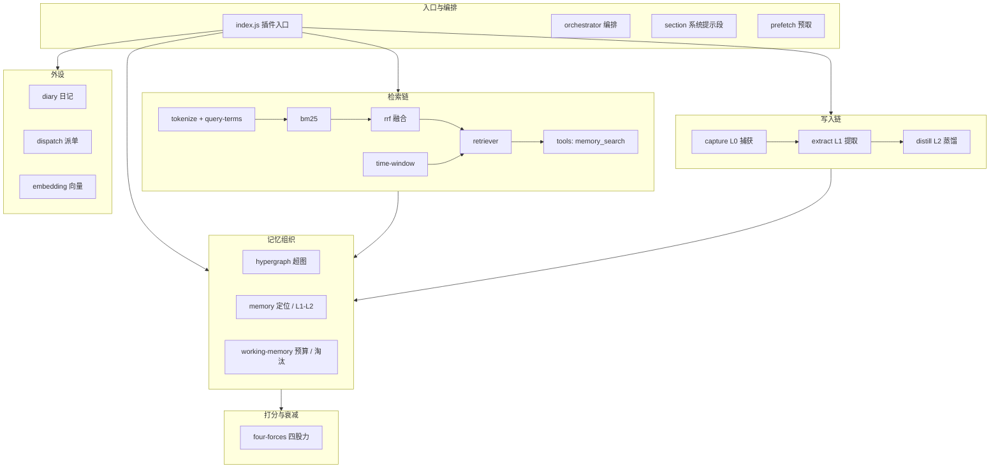

# 开源版结构图（dsh-unified-memory）

> 自动生成，勿手改。重新生成：node scripts/gen-structure.mjs（或 npm run structure）
> 生成时间：2026-11-10T12:50:39.141Z

## 一 · 总览

| 指标 | 数值 |
|---|---|
| 源码文件（lib，js/mjs/py） | 101 |
| 模块（一级目录） | 13 |
| 导出 API | 544 |
| 跨模块依赖边 | 36 |

## 二 · 分层图

## 三 · 模块清单

| 模块 | 职责 | 文件 | 导出 | 行数 |
|---|---|---:|---:|---:|
| `(root)` | 入口与编排 | 11 | 53 | 3584 |
| `ingest` | 写入链（L0 捕获 / L1 提取 / L2 蒸馏） | 25 | 150 | 7982 |
| `retrieval` | 检索链（BM25 / 重排 / 工具） | 16 | 83 | 6333 |
| `hypergraph` | 超图存储与索引 | 16 | 76 | 2899 |
| `memory` | 卡片定位与 L1-L2 关联 | 2 | 12 | 448 |
| `working-memory` | 分层工作记忆（预算 / 淘汰 / 扩散） | 7 | 49 | 1877 |
| `scoring` | 四股力 / 衰减 / 采纳 | 5 | 32 | 1308 |
| `scorer` | 基线打分 | 1 | 1 | 49 |
| `diary` | 日记 | 3 | 43 | 721 |
| `dispatch` | 派单台账与热重载 | 8 | 21 | 1620 |
| `embedding` | 向量索引 | 3 | 18 | 491 |
| `backends` | 存储后端 | 2 | 4 | 98 |
| `observe` | 日志与轮转 | 2 | 2 | 75 |

## 四 · 跨模块依赖边（按次数降序）

| 边 | 次数 |
|---|---:|
| `ingest` -> `(root)` | 19 |
| `(root)` -> `ingest` | 9 |
| `retrieval` -> `(root)` | 8 |
| `retrieval` -> `ingest` | 8 |
| `(root)` -> `embedding` | 5 |
| `(root)` -> `hypergraph` | 5 |
| `(root)` -> `dispatch` | 5 |
| `hypergraph` -> `(root)` | 4 |
| `hypergraph` -> `ingest` | 3 |
| `memory` -> `(root)` | 3 |
| `retrieval` -> `hypergraph` | 3 |
| `(root)` -> `backends` | 2 |
| `(root)` -> `retrieval` | 2 |
| `(root)` -> `working-memory` | 2 |
| `(root)` -> `diary` | 2 |
| `(root)` -> `scoring` | 2 |
| `backends` -> `(root)` | 2 |
| `ingest` -> `scoring` | 2 |
| `retrieval` -> `scoring` | 2 |
| `retrieval` -> `embedding` | 2 |
| `working-memory` -> `hypergraph` | 2 |
| `working-memory` -> `retrieval` | 2 |
| `(root)` -> `scorer` | 1 |
| `(root)` -> `observe` | 1 |
| `diary` -> `(root)` | 1 |
| `dispatch` -> `(root)` | 1 |
| `embedding` -> `hypergraph` | 1 |
| `embedding` -> `(root)` | 1 |
| `hypergraph` -> `scoring` | 1 |
| `hypergraph` -> `memory` | 1 |
| `ingest` -> `hypergraph` | 1 |
| `observe` -> `(root)` | 1 |
| `retrieval` -> `memory` | 1 |
| `scoring` -> `memory` | 1 |
| `scoring` -> `(root)` | 1 |
| `working-memory` -> `(root)` | 1 |

## 五 · 文件明细

### (root) · 入口与编排

- card-session.js
- dashboard.js
- endpoint-config.js
- faults.js
- index.js
- orchestrator.js
- paths.js
- prefetch.js
- scenes.js
- section.js
- shard-files.js

### ingest · 写入链（L0 捕获 / L1 提取 / L2 蒸馏）

- ingest/axioms.js
- ingest/belief.js
- ingest/capture.js
- ingest/concentrate.js
- ingest/config.js
- ingest/consolidate.js
- ingest/core.js
- ingest/distill.js
- ingest/entities.js
- ingest/entry-shadow.js
- ingest/extract.js
- ingest/graph.js
- ingest/html-strip.js
- ingest/index.js
- ingest/llm.js
- ingest/motifs.js
- ingest/normalize.js
- ingest/persona-drift.js
- ingest/persona.js
- ingest/refute-scan.js
- ingest/resolution.js
- ingest/scene-nav.js
- ingest/signal-miss.js
- ingest/title-clean.js
- ingest/verbatim-lookup.js

### retrieval · 检索链（BM25 / 重排 / 工具）

- retrieval/alias.js
- retrieval/bm25.js
- retrieval/breaker.js
- retrieval/embed-fallback-server.js
- retrieval/l0-normalize.js
- retrieval/query-terms.js
- retrieval/retriever.js
- retrieval/rrf.js
- retrieval/source-tracer.js
- retrieval/stages.js
- retrieval/startlux-rerank.js
- retrieval/time-window.js
- retrieval/tokenize.js
- retrieval/tools.js
- retrieval/types.js
- retrieval/zstd-extract.py

### hypergraph · 超图存储与索引

- hypergraph/auto-refresh.js
- hypergraph/backend.js
- hypergraph/build.js
- hypergraph/dedupe-titles.mjs
- hypergraph/edge.js
- hypergraph/episode.js
- hypergraph/index-shard.js
- hypergraph/l0-cache.js
- hypergraph/l0-rounds.js
- hypergraph/lock.js
- hypergraph/pipeline.js
- hypergraph/propagate.js
- hypergraph/source.js
- hypergraph/store.js
- hypergraph/topic.js
- hypergraph/types.js

### memory · 卡片定位与 L1-L2 关联

- memory/card-locator.js
- memory/l1-l2-link.js

### working-memory · 分层工作记忆（预算 / 淘汰 / 扩散）

- working-memory/activation-store.js
- working-memory/budget.js
- working-memory/evict.js
- working-memory/index.js
- working-memory/spread.js
- working-memory/types.js
- working-memory/working-memory.js

### scoring · 四股力 / 衰减 / 采纳

- scoring/adoption.js
- scoring/cold-archive.mjs
- scoring/four-forces.js
- scoring/importance.js
- scoring/shadow-decay.js

### scorer · 基线打分

- scorer/baseline.js

### diary · 日记

- diary/index.js
- diary/scheduler.js
- diary/tool.js

### dispatch · 派单台账与热重载

- dispatch/event-source.js
- dispatch/hotreload-exec.js
- dispatch/hotreload-guard.js
- dispatch/hotreload-probe.js
- dispatch/hotreload-tools.js
- dispatch/ledger.js
- dispatch/state-machine.js
- dispatch/tool.js

### embedding · 向量索引

- embedding/auto-build.js
- embedding/client.js
- embedding/index-store.js

### backends · 存储后端

- backends/engram.js
- backends/journal.js

### observe · 日志与轮转

- observe/log.js
- observe/rotate.js

## 六 · 说明

- 本图只覆盖 lib/（插件运行时代码），不含 scripts/（测试/工具）。
- 边为相对 import 的静态解析结果；动态 import() 若带变量不会被计入。
- 与生产版（normify-unified-memory）分属两棵树：本图只描述开源仓库自身。